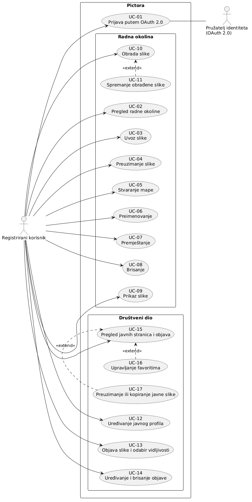

# 3. Obrasci uporabe

**Cilj:** Prikazati glavne interakcije između aktera aplikacije i sustava. Opišite kako akter ostvaruje cilj i što se događa kada važan korak ne uspije. Interakcije temeljite na odobrenim zahtjevima i ažurirajte ih kako se aplikacija razvija.

## 3.1 Dijagram obrazaca uporabe

**Cilj:** Prikazati granicu sustava, relevantne aktere i njihove glavne ciljeve u **preglednom UML dijagramu obrazaca uporabe**. Ako je za razumijevanje pojedinog dijela sustava potrebno prikazati više detalja, taj dio izdvojite u dodatni usmjereni dijagram. Dodatni dijagrami trebaju produbiti dio preglednog modela, a ne stvarati nepovezane ili duplicirane prikaze istog sustava.

**Slika 3.1. Dijagram obrazaca uporabe sustava Pictora**

**PlantUML izvor:** [izvor](./puml/3-1-pictora-UC.puml)

**Provjera dijagrama:** Prikažite prepoznate uloge koje **komuniciraju s aplikacijom**, a ne dionike koji s njom nemaju interakciju. Svaki glavni korisnički cilj mora imati pridruženog aktera; uključeni obrazac uporabe može se dosegnuti preko drugog obrasca uporabe bez vlastite izravne veze s akterom. `<<include>>` i `<<extend>>` koristite samo kada odnos odgovara stvarnom ponašanju.

<strong>Primjer aktera i granica sustava</strong>

**Opis primjera — CrisisMap:**

Dijagram prikazuje **ogledni scenarij** s građaninom, posjetiteljem i koordinatorom pomoći te vanjskim pružateljem identiteta. Pružatelj identiteta sudjeluje u obrascu uporabe „Prijava u sustav” kao sekundarni akter: korisnik pokreće prijavu u aplikaciji, a vanjski sustav provodi autentikaciju. Budući da projekt koristi vanjskog pružatelja identiteta, ta se ovisnost prikazuje i u dijagramu obrazaca uporabe; tehnički detalji integracije pripadaju arhitekturnoj dokumentaciji.

**Odabir aktera i ciljeva:** Granica pokazuje što aplikacija nudi, akteri imaju različite ciljeve, a nijedan akter ni obrazac uporabe ne tvrdi da ova studentska aplikacija angažira hitne službe. Dijagram usporedite s odobrenim funkcijskim zahtjevima i akterima.

**Pet pitanja za odabir sadržaja dijagrama** (ne pet dijagrama za predaju):

| Fokus | Pitanje |
| --- | --- |
| Cijeli sustav | Koji korisnički ciljevi najbolje objašnjavaju čemu ova aplikacija služi? |
| Ključne funkcionalnosti | Koje ciljeve treba detaljnije opisati ili, ako je potrebno, prikazati zasebnim usmjerenim dijagramom? |
| Korisničke uloge | Koji akteri mogu sudjelovati u pojedinom cilju i kako se njihove ovlasti razlikuju? |
| Ključni procesi | Koji cilj ima važne alternative koje treba opisati u obrascu uporabe? |
| Vanjske integracije | Sudjeluje li drugi sustav u obrascu uporabe kao **sekundarni akter**, primjerice odobreni pružatelj identiteta pri prijavi? |

Vanjski sustav može biti sekundarni akter obrasca uporabe kada sudjeluje u ostvarenju korisničkog cilja; tehničke veze opisuju se u arhitekturi. Nemojte stvarati dodatni obavezni dijagram obrazaca uporabe samo radi popisa integracija. Prenatrpan dijagram podijelite prema povezanim akterima ili ciljevima samo kada time postaje čitljiviji.

## 3.2 Specifikacije obrazaca uporabe

**Cilj:** Za svaki obrazac uporabe iz dijagrama objasniti cilj aktera, uobičajenu interakciju s aplikacijom i važne alternative. Jednostavne obrasce uporabe opišite kratko; proširite one kod kojih alternative, vanjske ovisnosti ili posljedice zahtijevaju dodatno objašnjenje.

**Za svaki obrazac uporabe koristite jednu okomitu tablicu.** Navedite samo onoliko pojedinosti koliko interakcija zahtijeva; neprimjenjivu alternativu izostavite umjesto da je popunjavate samo radi forme.

### UC-01: Prijava putem vanjskog pružatelja identiteta

| Element specifikacije | Opis |
| :--- | :--- |
| **Primarni akter** | Registrirani korisnik |
| **Sekundarni akter** | Pružatelj identiteta (OAuth 2.0) |
| **Povezani zahtjevi** | F-004, F-005, F-010 |
| **Preduvjeti** | Korisnik nije prijavljen i ima račun kod pružatelja identiteta. |
| **Glavni uspješni tok** | 1. Korisnik otvori aplikaciju; sustav ga preusmjeri na stranicu za prijavu. 2. Korisnik odabere prijavu putem pružatelja identiteta. 3. Sustav preusmjeri korisnika pružatelju identiteta. 4. Korisnik se autentificira i odobri pristup. 5. Pružatelj identiteta vrati korisnika sustavu s potvrdom identiteta. 6. Sustav prepozna korisnika; ako se prijavljuje prvi put, stvori račun, radnu okolinu i u nju doda tri početne slike. 7. Sustav uspostavi sesiju i prikaže radnu okolinu. |
| **Alternativni tokovi / Iznimke** | **4a — Korisnik odbije pristup ili odustane:** pružatelj identiteta vrati korisnika bez potvrde, sustav prikaže stranicu za prijavu s porukom i korisnik može pokušati ponovno. **5a — Potvrda identiteta nije valjana ili pružatelj nije dostupan:** sustav ne uspostavlja sesiju, prikaže poruku o neuspjehu i ostaje na stranici za prijavu. **6a — Stvaranje računa ili početnih slika nije uspjelo:** sustav ne dovršava prijavu, prikaže poruku i korisnik može pokušati ponovno. |
| **Posljedice (ishod)** | Korisnik ima aktivnu sesiju i pristup samo svojoj radnoj okolini. Pri prvoj prijavi postoje račun i tri početne slike. |

### UC-02: Pregled radne okoline

| Element specifikacije | Opis |
| :--- | :--- |
| **Primarni akter** | Registrirani korisnik |
| **Povezani zahtjevi** | F-002, F-005 |
| **Preduvjeti** | Korisnik je prijavljen. |
| **Glavni uspješni tok** | 1. Korisnik otvori radnu okolinu. 2. Sustav prikaže stablo mapa i sadržaj odabrane mape (podmape i slike s pregledima). 3. Korisnik odabere drugu mapu u stablu ili putem staze (breadcrumbs). 4. Sustav prikaže sadržaj te mape. |
| **Alternativni tokovi / Iznimke** | **2a — Mapa je prazna:** sustav prikaže prazno stanje s uputom za uvoz slika. **2b — Sadržaj se ne može dohvatiti:** sustav prikaže poruku o grešci i mogućnost ponovnog pokušaja. **2c — Sesija je istekla:** sustav preusmjeri korisnika na prijavu. |
| **Posljedice (ishod)** | Nema promjene podataka. Korisnik vidi isključivo svoje mape i slike. |

### UC-03: Uvoz slike u radnu okolinu

| Element specifikacije | Opis |
| :--- | :--- |
| **Primarni akter** | Registrirani korisnik |
| **Povezani zahtjevi** | F-001, F-002, F-005 |
| **Preduvjeti** | Korisnik je prijavljen i nalazi se u mapi svoje radne okoline. |
| **Glavni uspješni tok** | 1. Korisnik odabere uvoz (gumb ili povlačenje datoteka u mapu). 2. Korisnik odabere jednu ili više rasterskih slika s računala. 3. Sustav provjeri format i veličinu svake datoteke. 4. Sustav pohrani slike u odabranu mapu i prikaže napredak. 5. Sustav prikaže nove slike u popisu mape. |
| **Alternativni tokovi / Iznimke** | **3a — Nepodržani format:** sustav odbije tu datoteku, prikaže jasnu poruku (NF-03) i nastavi s ostalima. **3b — Datoteka prevelika ili oštećena:** sustav je odbije uz poruku i nastavi s ostalima. **4a — Greška pri pohrani:** sustav prikaže poruku, slika se ne dodaje, korisnik može pokušati ponovno. |
| **Posljedice (ishod)** | Slike su pohranjene u odabranoj mapi u radnoj okolini korisnika i vidljive samo njemu. |

### UC-04: Preuzimanje slike u odabranom formatu

| Element specifikacije | Opis |
| :--- | :--- |
| **Primarni akter** | Registrirani korisnik |
| **Povezani zahtjevi** | F-001 |
| **Preduvjeti** | Korisnik je prijavljen i slika postoji u njegovoj radnoj okolini. |
| **Glavni uspješni tok** | 1. Korisnik odabere sliku i radnju preuzimanja. 2. Sustav ponudi dostupne formate. 3. Korisnik odabere format. 4. Sustav pripremi sliku u tom formatu i pokrene preuzimanje na računalo korisnika. |
| **Alternativni tokovi / Iznimke** | **3a — Korisnik odustane:** ništa se ne preuzima. **4a — Pretvorba u odabrani format nije uspjela:** sustav prikaže poruku i ponudi drugi format. |
| **Posljedice (ishod)** | Korisnik ima datoteku na računalu. Slika u radnoj okolini ostaje nepromijenjena. |

### UC-05: Stvaranje mape

| Element specifikacije | Opis |
| :--- | :--- |
| **Primarni akter** | Registrirani korisnik |
| **Povezani zahtjevi** | F-002 |
| **Preduvjeti** | Korisnik je prijavljen i nalazi se u mapi svoje radne okoline. |
| **Glavni uspješni tok** | 1. Korisnik odabere stvaranje nove mape. 2. Korisnik unese naziv. 3. Sustav provjeri naziv i stvori mapu unutar trenutne mape. 4. Sustav prikaže novu mapu u stablu i popisu. |
| **Alternativni tokovi / Iznimke** | **3a — Naziv je prazan ili nevaljan:** sustav prikaže poruku i ne stvara mapu. **3b — Mapa s tim nazivom već postoji na toj razini:** sustav prikaže poruku i traži drugi naziv. **3c — Spremanje nije uspjelo:** sustav prikaže poruku, mapa se ne stvara. |
| **Posljedice (ishod)** | Nova prazna mapa postoji u radnoj okolini korisnika. |

### UC-06: Preimenovanje mape ili slike

| Element specifikacije | Opis |
| :--- | :--- |
| **Primarni akter** | Registrirani korisnik |
| **Povezani zahtjevi** | F-002 |
| **Preduvjeti** | Korisnik je prijavljen i mapa ili slika postoji u njegovoj radnoj okolini. |
| **Glavni uspješni tok** | 1. Korisnik odabere mapu ili sliku i radnju preimenovanja. 2. Korisnik unese novi naziv. 3. Sustav provjeri naziv i spremi promjenu. 4. Sustav prikaže novi naziv. |
| **Alternativni tokovi / Iznimke** | **3a — Naziv je prazan ili nevaljan:** sustav prikaže poruku, naziv ostaje stari. **3b — Naziv već postoji na toj razini:** sustav prikaže poruku i traži drugi naziv. **3c — Spremanje nije uspjelo:** sustav prikaže poruku, naziv ostaje stari. |
| **Posljedice (ishod)** | Stavka ima novi naziv. Njezin sadržaj i položaj nisu promijenjeni. |

### UC-07: Premještanje mape ili slike

| Element specifikacije | Opis |
| :--- | :--- |
| **Primarni akter** | Registrirani korisnik |
| **Povezani zahtjevi** | F-002 |
| **Preduvjeti** | Korisnik je prijavljen i stavka postoji u njegovoj radnoj okolini. |
| **Glavni uspješni tok** | 1. Korisnik odabere stavku i povuče je u drugu mapu ili odabere radnju "Premjesti u...". 2. Korisnik odabere odredišnu mapu. 3. Sustav provjeri premještanje i promijeni položaj stavke. 4. Sustav prikaže stavku u odredišnoj mapi. |
| **Alternativni tokovi / Iznimke** | **3a — Mapa se pokušava premjestiti u samu sebe ili u vlastitu podmapu:** sustav odbije premještanje uz poruku. **3b — U odredišnoj mapi već postoji stavka s istim nazivom:** sustav odbije premještanje uz poruku. **3c — Spremanje nije uspjelo:** sustav prikaže poruku, stavka ostaje na starom mjestu. |
| **Posljedice (ishod)** | Stavka (s cijelim sadržajem ako je mapa) nalazi se u odredišnoj mapi. |

### UC-08: Brisanje mape ili slike

| Element specifikacije | Opis |
| :--- | :--- |
| **Primarni akter** | Registrirani korisnik |
| **Povezani zahtjevi** | F-002 |
| **Preduvjeti** | Korisnik je prijavljen i stavka postoji u njegovoj radnoj okolini. |
| **Glavni uspješni tok** | 1. Korisnik odabere stavku i radnju brisanja. 2. Sustav zatraži potvrdu; za mapu navede broj stavki koje će biti obrisane. 3. Korisnik potvrdi. 4. Sustav obriše stavku, a za mapu i sav njezin sadržaj. 5. Sustav ukloni stavku iz prikaza. |
| **Alternativni tokovi / Iznimke** | **3a — Korisnik odustane:** ništa se ne briše. **4a — Brisanje nije uspjelo:** sustav prikaže poruku, stavka ostaje. |
| **Posljedice (ishod)** | Stavka i njezin sadržaj više ne postoje u radnoj okolini korisnika. |

### UC-09: Prikaz slike

| Element specifikacije | Opis |
| :--- | :--- |
| **Primarni akter** | Registrirani korisnik |
| **Povezani zahtjevi** | F-003 |
| **Preduvjeti** | Korisnik je prijavljen i slika postoji u njegovoj radnoj okolini. |
| **Glavni uspješni tok** | 1. Korisnik odabere sliku. 2. Sustav prikaže sliku u pregledniku slika zajedno s osnovnim podacima (naziv, format, dimenzije, veličina). 3. Korisnik po potrebi povećava i pomiče sliku ili prelazi u uređivanje (UC-10). |
| **Alternativni tokovi / Iznimke** | **2a — Preglednik ne može prikazati izvorni format (npr. TIFF):** sustav prikaže pretvoreni pregled i obavijesti korisnika. **2b — Slika se ne može učitati:** sustav prikaže poruku i mogućnost ponovnog pokušaja. |
| **Posljedice (ishod)** | Nema promjene podataka. |

### UC-10: Obrada slike

| Element specifikacije | Opis |
| :--- | :--- |
| **Primarni akter** | Registrirani korisnik |
| **Povezani zahtjevi** | F-003, F-003.1, F-003.2, F-003.3, F-003.4 |
| **Preduvjeti** | Korisnik je prijavljen i otvorio je sliku u uređivaču. |
| **Glavni uspješni tok** | 1. Korisnik odabere vrstu obrade: filtar, morfološki operator, geometrijsku transformaciju ili segmentaciju. 2. Korisnik po potrebi postavi parametre operacije. 3. Sustav primijeni operaciju i prikaže rezultat. 4. Korisnik ponavlja korake 1 do 3 ili poništava promjene. |
| **Alternativni tokovi / Iznimke** | **2a — Parametri su nevaljani:** sustav prikaže poruku i ne primjenjuje operaciju. **3a — Operacija nije uspjela (npr. slika je prevelika):** sustav prikaže poruku, slika ostaje kakva je bila prije operacije. |
| **Posljedice (ishod)** | Prikazana slika sadrži primijenjene operacije. Izvorna datoteka se ne mijenja dok korisnik ne spremi (UC-11). |

### UC-11: Spremanje obrađene slike

| Element specifikacije | Opis |
| :--- | :--- |
| **Primarni akter** | Registrirani korisnik |
| **Povezani zahtjevi** | F-003, F-002 |
| **Preduvjeti** | Korisnik je obradio sliku u uređivaču (UC-10). |
| **Glavni uspješni tok** | 1. Korisnik odabere spremanje. 2. Korisnik odabere hoće li rezultat spremiti kao novu datoteku ili prepisati izvornu. 3. Za novu datoteku korisnik unese naziv i odabere mapu; za prepisivanje sustav traži potvrdu. 4. Sustav pohrani sliku i prikaže potvrdu. |
| **Alternativni tokovi / Iznimke** | **3a — Naziv nevaljan ili već postoji u odabranoj mapi:** sustav prikaže poruku i traži drugi naziv. **3b — Korisnik odustane od prepisivanja:** izvorna datoteka ostaje nepromijenjena. **4a — Pohrana nije uspjela:** sustav prikaže poruku, izvorna slika ostaje nepromijenjena, a obrađeni rezultat ostaje u uređivaču. |
| **Posljedice (ishod)** | Obrađena slika postoji kao nova datoteka ili je zamijenila izvornu. |

### UC-12: Uređivanje javnog profila

| Element specifikacije | Opis |
| :--- | :--- |
| **Primarni akter** | Registrirani korisnik |
| **Povezani zahtjevi** | F-006 |
| **Preduvjeti** | Korisnik je prijavljen u sustav. |
| **Glavni uspješni tok** | 1. Korisnik otvara postavke svog profila. 2. Sustav prikazuje trenutačno korisničko ime, prikazano ime i kratki opis korisnika. 3. Korisnik mijenja željene podatke i odabire spremanje. 4. Sustav provjerava valjanost unosa i sprema izmjene. 5. Sustav prikazuje ažurirane podatke na javnoj stranici korisnika. |
| **Alternativni tokovi / Iznimke** | **4a — Prazno korisničko ime:** sustav ne prihvaća prazan unos i zadržava valjano korisničko ime. |
| **Posljedice (ishod)** | Podaci na javnoj stranici korisnika su ažurirani. |

### UC-13: Objava slike i odabir vidljivosti

| Element specifikacije | Opis |
| :--- | :--- |
| **Primarni akter** | Registrirani korisnik |
| **Povezani zahtjevi** | F-006, F-007 |
| **Preduvjeti** | Korisnik je prijavljen i posjeduje rastersku sliku za objavu. |
| **Glavni uspješni tok** | 1. Korisnik na svojoj javnoj stranici odabire opciju za novu objavu. 2. Korisnik odabire sliku, unosi tekstualni opis (npr. opis kako je slika nastala) te bira vidljivost (**Javno** ili **Privatno**). 3. Korisnik potvrđuje objavu. 4. Sustav sprema objavu i prikazuje je na profilu korisnika. |
| **Alternativni tokovi / Iznimke** | **2a — Korisnik odustane od unosa:** zatvaranjem obrasca objava se ne sprema i profil ostaje nepromijenjen. |
| **Posljedice (ishod)** | Objava je pohranjena na profilu korisnika; javna objava vidljiva je svim prijavljenim korisnicima, a privatna samo vlasniku profila. |

### UC-14: Uređivanje i brisanje objave

| Element specifikacije | Opis |
| :--- | :--- |
| **Primarni akter** | Registrirani korisnik |
| **Povezani zahtjevi** | F-006, F-007 |
| **Preduvjeti** | Korisnik je prijavljen i ima barem jednu objavu na svojoj javnoj stranici. |
| **Glavni uspješni tok** | 1. Korisnik na vlastitoj objavi odabire promjenu vidljivosti (javno/privatno), uređivanje tekstualnog opisa ili brisanje objave. 2. Sustav sprema izmjenu opisa/vidljivosti ili uklanja objavu s profila. 3. Sustav ažurira prikaz objava na profilu i u pregledu javnih objava. |
| **Alternativni tokovi / Iznimke** | **1a — Odustajanje od uređivanja:** korisnik zatvara prozor za uređivanje bez spremanja te opis ostaje nepromijenjen. |
| **Posljedice (ishod)** | Objava je ažurirana ili obrisana s javne stranice korisnika. |

### UC-15: Pregled javnih stranica i objava

| Element specifikacije | Opis |
| :--- | :--- |
| **Primarni akter** | Registrirani korisnik |
| **Povezani zahtjevi** | F-007, F-008 |
| **Preduvjeti** | Korisnik je prijavljen u sustav. |
| **Glavni uspješni tok** | 1. Korisnik otvara stranicu *Explore* i po želji upisuje pojam za pretragu. 2. Sustav prikazuje javne profile korisnika i sve objave označene kao **javne** (dok su privatne objave skrivene). 3. Korisnik može otvoriti javnu stranicu odabranog korisnika i pregledati njegov opis i njegove javne objave. |
| **Alternativni tokovi / Iznimke** | **2a — Nema rezultata za upisani pojam:** sustav prikazuje obavijest da nema pronađenih javnih objava. |
| **Posljedice (ishod)** | Korisniku su prikazane javne stranice i javne objave drugih korisnika. |

### UC-16: Upravljanje favoritima

| Element specifikacije | Opis |
| :--- | :--- |
| **Primarni akter** | Registrirani korisnik |
| **Povezani zahtjevi** | F-008 |
| **Preduvjeti** | Korisnik je prijavljen i pregledava javne objave ili javne stranice drugih korisnika. |
| **Glavni uspješni tok** | 1. Korisnik odabire opciju dodavanja u favorite na pojedinoj javnoj objavi ili na javnoj stranici drugog korisnika. 2. Sustav sprema odabranu objavu ili javnu stranicu u popis favorita. 3. Korisnik na stranici *Favorites* pregledava spremljene objave i javne stranice te ih po želji uklanja iz favorita. |
| **Alternativni tokovi / Iznimke** | **3a — Objava u favoritima postane privatna:** sustav takvu objavu više ne prikazuje u popisu favorita drugim korisnicima. |
| **Posljedice (ishod)** | Popis favorita korisnika je ažuriran. |

### UC-17: Preuzimanje ili kopiranje javne slike

| Element specifikacije | Opis |
| :--- | :--- |
| **Primarni akter** | Registrirani korisnik |
| **Povezani zahtjevi** | F-009 |
| **Preduvjeti** | Korisnik je prijavljen i pregledava javnu objavu drugog korisnika. |
| **Glavni uspješni tok** | 1. Korisnik na tuđoj javnoj objavi odabire **Preuzmi** ili **Kopiraj u radnu okolinu**. 2. Ako je odabrano preuzimanje, rasterska slika sprema se lokalno na računalo korisnika. 3. Ako je odabrano kopiranje u radnu okolinu, sustav sprema kopiju slike u korisnikovu radnu okolinu i prikazuje poruku potvrde. |
| **Alternativni tokovi / Iznimke** | **1a — Objava više nije dostupna:** sustav ne izvršava radnju i obavještava korisnika. |
| **Posljedice (ishod)** | Slika s tuđe javne stranice preuzeta je lokalno ili dodana u radnu okolinu korisnika. |

<strong>Primjeri specifikacija: Registracija i prijava kriznog događaja</strong>

**Primjer — CrisisMap:**

**UC-001: Registracija računa.** Ovaj kratki primjer odnosi se na projekt čiji odobreni zadatak uključuje račune s adresom e-pošte i lozinkom.

| Polje | Opis |
| --- | --- |
| Primarni akter | Građanin (A-02 u primjeru) |
| ID zahtjeva | F-001 |
| Preduvjeti, ako postoje | Nema. |
| Glavni tijek | Građanin unosi adresu e-pošte; aplikacija šalje poveznicu za potvrdu; građanin potvrđuje račun. |
| Alternativni ili neuspješni tijekovi, ako postoje | Adresa e-pošte već postoji → aplikacija objašnjava zašto se registracija ne može nastaviti. |
| Rezultat | Račun je aktivan nakon potvrde. |

Ako odobreni zadatak umjesto toga koristi isključivo OAuth prijavu, zamijenite ovaj primjer odgovarajućim ponašanjem prijave; nemojte dodavati registraciju lokalnom lozinkom samo radi podudaranja s primjerom.

**UC-002: Podnošenje prijave kriznog događaja.** Ista polja mogu opisati dulji tijek u kojem odabir lokacije, provjera valjanosti i pohrana mogu ne uspjeti.

| Polje | Opis |
| --- | --- |
| Primarni akter | Građanin |
| ID zahtjeva | F-004 |
| Preduvjeti, ako postoje | Obrazac za prijavu dostupan je. Ako odobreni zadatak zahtijeva prijavu u sustav, građanin je prijavljen. |
| Glavni tijek | 1. Građanin otvara obrazac za prijavu; aplikacija prikazuje polja za vrstu kriznog događaja, razinu ozbiljnosti, opis i lokaciju. 2. Građanin unosi podatke i odabire lokaciju na karti ili drugim podržanim načinom. 3. Građanin podnosi obrazac; aplikacija provjerava obavezna polja i lokaciju. 4. Aplikacija pohranjuje prijavu i prikazuje potvrdu s referencom na nju. |
| Alternativni ili neuspješni tijekovi, ako postoje | **1a — Prijava u sustav nije uspjela:** Ako je prijava obavezna, a pružatelj identiteta je ne dovrši, prijava kriznog događaja ostaje nepodnesena i aplikacija objašnjava kako pokušati ponovno. **2a — Odbijen pristup lokaciji:** Ako aplikacija nudi geolokaciju, ali je korisnik odbije, građanin ručno odabire lokaciju ako ta mogućnost postoji; tijek se nastavlja u koraku 3. **3a — Nevaljana ili nedostajuća lokacija:** Aplikacija objašnjava problem, po mogućnosti zadržava unesene podatke i ne pohranjuje prijavu; građanin ispravlja lokaciju i ponavlja korak 3. **3b — Pohrana nije uspjela:** Aplikacija prijavljuje neuspjeh i ne prikazuje lažnu potvrdu o podnošenju. |
| Rezultat | Aplikacija pohranjuje prijavu kriznog događaja i potvrđuje njezino podnošenje. |

**Odabir razine detalja:** Oba primjera koriste ista polja. UC-001 je kratak jer je glavna iznimka jasna; UC-002 zahtijeva numerirane korake i alternative jer oni mijenjaju ishod i mogu usmjeravati ispitivanje.Pri prilagodbi primjera koristite ID-ove zahtjeva i ponašanje vlastite aplikacije.

**UC-005: Moderiranje prijave kriznog događaja.** Ovaj primjer vrijedi samo za projekt u kojem odobreni opseg uključuje moderatorski pregled prijava.

| Polje | Opis |
| --- | --- |
| Primarni akter | Moderator (A-05 u primjeru) |
| ID zahtjeva | F-008 |
| Preduvjeti, ako postoje | Moderator je prijavljen i ima moderatorske ovlasti; postoji prijava koja čeka pregled. |
| Glavni tijek | 1. Moderator otvara prijavu koja čeka pregled. 2. Aplikacija prikazuje podatke prijave i dostupne moderatorske radnje. 3. Moderator odabire odobravanje ili odbijanje. 4. Aplikacija provjerava ovlasti, mijenja status prijave i prikazuje novi status. |
| Alternativni ili neuspješni tijekovi, ako postoje | **3a — Radnja nije potvrđena:** Moderator odustaje od promjene i prijava ostaje nepromijenjena. **4a — Ovlasti nisu valjane:** Aplikacija odbija promjenu i status prijave ostaje nepromijenjen. |
| Rezultat | Prijava ima novi status ako je moderatorska radnja uspješno provedena; inače ostaje nepromijenjena. |

---

## 3.3 Provjera dosljednosti obrazaca uporabe

**Cilj:** Provjeriti međusobnu usklađenost obrazaca uporabe, aktera, zahtjeva i ispitnih slučajeva. Cjelovito mapiranje održava se isključivo u **[matrici sljedivosti zahtjeva](2-Analiza-zahtjeva.md#26-sljedivost-zahtjeva)**.

| Provjera | Pitanje za tim |
| --- | --- |
| Zahtjev | Je li svaki važan obrazac uporabe povezan s postojećim zahtjevom? |
| Akter | Odgovara li akter naveden ovdje prethodno utvrđenoj ulozi i dopuštenoj interakciji? |
| Aplikacija | Može li tim demonstrirati opisani glavni rezultat i važnu alternativu ili je opis jasno označen kao trenutačno oblikovanje? |

---

Povezivanje zahtjev → obrazac uporabe → ispitivanje održavajte **samo jednom, u [tablici sljedivosti zahtjeva](./2-Analiza-zahtjeva.md)**. Ovdje nemojte održavati drugu projektnu tablicu mapiranja ni stupac sa statusom implementacije. Ako važan zahtjev nema interakciju s ljudskim akterom, objasnite gdje se obrađuje umjesto izmišljanja aktera.

<strong>Provjera pokrivenosti zahtjeva</strong>

**Primjer — CrisisMap:** Tablica pokrivenosti obrazaca uporabe koju treba analizirati:

| Broj obrasca uporabe | Naziv obrasca uporabe | Obuhvaćeni funkcijski zahtjevi |
| --- | --- | --- |
| UC-001 | Registracija računa | F-001: Registracija računa putem e-pošte |
| UC-002 | Prijava kriznog događaja | F-022: Prijava i provjera kriznog događaja |
| UC-003 | Sustav upozorenja | F-045: Slanje upozorenja korisnicima i timovima |
| UC-004 | Koordinacija spašavanja | F-067: Koordinacija s hitnim službama |

---

**Problemi pokrivenosti koje treba riješiti:**

- **Pogrešan ID zahtjeva:** ova tablica povezuje UC-002 s F-022, dok se opis UC-002 u odjeljku 3.2 poziva na F-004, zahtjev za podnošenje prijave iz odjeljka 2.1.
- **Zahtjevi koji ne postoje:** F-022, F-045 i F-067 nisu definirani u oglednim zahtjevima u 2.1.
- **Obrasci uporabe bez opisa:** UC-003 i UC-004 nemaju opis u 3.2. UC-004 (koordinacija s hitnim službama) ujedno je mogućnost s vanjskim posljedicama koju opseg dopušta samo ako je uključena u odobreni zadatak.
- **Nesklad aktera:** primjer aktera u odjeljku 2.3 navodi da koordinator pomoći podnosi prijave (F-004), dok UC-002 kao primarnog aktera navodi građanina.

**Završna provjera:** Dijagram, specifikacije obrazaca uporabe i matrica sljedivosti međusobno su usklađeni. Svaki važan obrazac uporabe povezan je s postojećim zahtjevom, akteri odgovaraju stvarnim ulogama u aplikaciji, a opisani glavni i alternativni tijekovi odgovaraju ponašanju koje sustav stvarno podržava.