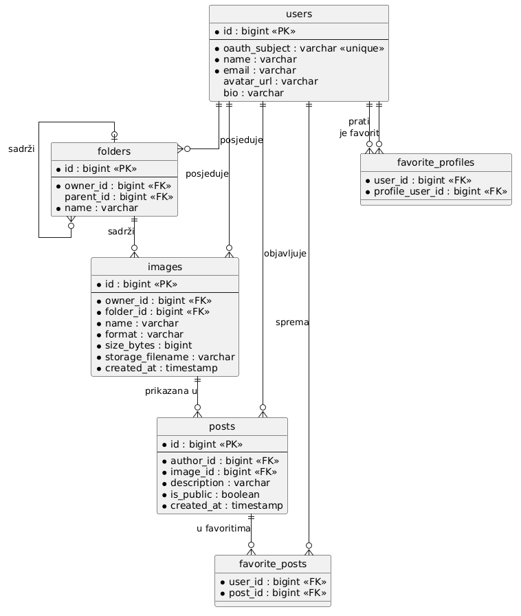
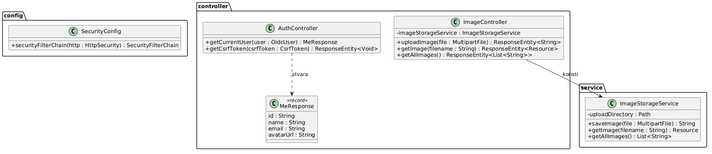

# 4. Arhitektura i oblikovanje

**Cilj:** Definirati arhitekturni stil, dekompoziciju programa na podsustave i module, organizaciju podataka te dinamičko ponašanje tijekom izvođenja. Arhitektura predstavlja temelj za implementaciju i ažurira se pri svakoj važnijoj promjeni projektnih odluka.

| Arhitekturni pogled | Ključno inženjersko pitanje | Primijenjeni model ili dijagram |
| :--- | :--- | :--- |
| **Strategija rješenja** | Koji stil i temeljne odluke određuju program? | Tablica odluka (odjeljak 4.1) |
| **Struktura podsustava** | Koji su glavni dijelovi i kako komuniciraju? | Dijagram komponenata |
| **Model podataka** | Kako su strukturirani trajni podaci programa? | Relacijski ER dijagram |
| **Struktura koda** | Kako su dodijeljene odgovornosti i ključne klase? | Reprezentativni dijagram razreda |
| **Dinamičko ponašanje** | Kako moduli surađuju pri obradi ključnih transakcija? | sekvencijski dijagram |
| **Stanja sustava** | Kako ključni domenski objekt mijenja svoja stanja? | Dijagram stanja |
| **Fizički razmještaj** | Na kojim se izvršnim čvorovima program izvodi? | Dijagram razmještaja (poglavlje 6) |

---

Za svaki UML dijagram čuvajte čitljivu sliku i PlantUML izvor, kako je opisano na stranici [Home](./Home.md). U dovršenoj stranici koristite vlastite projektne odluke i modele.

## 4.1 Ključne arhitekturne odluke

**Cilj:** Objasniti nekoliko arhitekturnih odluka koje najviše utječu na rješenje i navesti njihove projektno specifične razloge.

| Odluka | Razmatrana alternativa | Projektno specifično obrazloženje i kompromis |
| :--- | :--- | :--- |
| Jednostranična web aplikacija (React) koja s poslužiteljem komunicira samo preko REST API-ja pod '/api' | Stranice generirane na poslužitelju | Stablo mapa, pregled slika i uređivač traže puno interakcije bez ponovnog učitavanja stranice, a jasno sučelje API-ja omogućuje da frontend i backend razvijaju različiti članovi paralelno. Kompromis: dva projekta koja treba uskladiti (oblik odgovora, proxy u razvoju, sesije i CSRF). |
| Mantine kao biblioteka komponenti sučelja | gluestack UI | Mantine ima gotove komponente koje zadatak traži (drag-and-drop upload, dijalozi s potvrdom, obavijesti o greškama) i radi u web projektu bez dodatne konfiguracije. gluestack je usmjeren na zajedničko sučelje za web i mobilne aplikacije, što projekt ne treba. Kompromis: vezanost uz Mantineov API i stil, a svi članovi koji rade sučelje moraju koristiti istu biblioteku. |
| TanStack Query za dohvat podataka | Ručni 'fetch' sa stanjima u svakoj komponenti | Biblioteka vodi stanja učitavanja i greške te kešira odgovore, pa se dohvat svake vrste podataka piše na jednom mjestu (hook u 'frontend/src/api'). Kompromis: dodatna ovisnost i pojmovi (ključevi upita, osvježavanje keša) koje tim mora naučiti. |
| Mock Service Worker za razvoj bez backenda | Čekanje na gotov backend | Frontend se razvija prije gotovih endpointa, a komponente pišu prave HTTP zahtjeve, pa prelazak na pravi backend znači samo drugačije pokretanje ('npm run dev' umjesto 'npm run dev:mock'). Kompromis: mockovi se mogu razilaziti od stvarnog API-ja, pa ih treba uskladiti s oblikom odgovora koji backend stvarno vraća. |
| Prijava se u cijelosti odvija na poslužitelju (Spring Security, OAuth 2.0 s Googleom, sesija), a frontend samo pita 'GET /api/me' i štiti rute prema odgovoru | Frontend sam vodi OAuth tok i čuva token | Tajne i sesija ostaju na poslužitelju, a neprijavljeni zahtjevi prema '/api/**' dobivaju status 401 umjesto preusmjeravanja, što aplikacija u pregledniku jednostavno obrađuje. Kompromis: u razvoju frontend i backend moraju dijeliti izvor (proxy) da bi sesija radila, zahtjevi koji mijenjaju podatke traže CSRF token ('GET /api/csrf'), a adrese preusmjeravanja nakon prijave trenutno su upisane u kod. |
| Obrada slika u pregledniku (ImageJS) | Obrada na poslužitelju | Rezultat operacije vidi se odmah i ne opterećuje poslužitelj, a zadatak dopušta vanjski API poput ImageJS-a. Kompromis: velike slike troše memoriju preglednika, a obrađeni rezultat se pri spremanju mora poslati backendu. |
| Jedna Spring Boot aplikacija koja izlaže REST API | Više zasebno postavljenih usluga | Opseg projekta i veličina tima traže jednu aplikaciju koja se gradi i pokreće jednom naredbom (Maven wrapper), a odgovornosti (autentifikacija, pohrana slika) razdvojene su u pakete i razrede. Kompromis: kvar jednog dijela zaustavlja cijelu aplikaciju, a dijelovi se ne mogu zasebno skalirati. |
| Slike se pohranjuju kao datoteke u direktoriju 'uploads' na poslužitelju pod jedinstvenim (UUID) nazivom | Pohrana sadržaja slike u bazu podataka | Datoteke se jednostavno poslužuju i ne opterećuju bazu, a jedinstveni nazivi i provjera putanje sprječavaju sudaranje naziva i pristup datotekama izvan direktorija. Kompromis: pohrana je vezana uz disk jedne instance (pri postavljanju treba trajni volumen), a podaci o vlasniku, mapi i izvornom nazivu slike traže zasebnu evidenciju u bazi. |

Objasnite glavne arhitekturne odluke bez ponavljanja popisa tehnologija. Ako važna odluka ima ADR, dovoljno je u tablici navesti njegov ID.

<strong>Primjer arhitekturnih odluka i kompromisa</strong>

**Primjer — CrisisMap:**

| Odluka | Razmatrana alternativa | Projektno specifično obrazloženje i kompromis |
| --- | --- | --- |
| Klijent u pregledniku i jedan poslužiteljski API | Više zasebno postavljenih poslužiteljskih usluga | Klijent prikazuje kartu, dok poslužiteljski sustav provjerava i pohranjuje prijave. Jedan poslužiteljski sustav upravljiv je za ovaj opseg; njegov kvar može privremeno prekinuti rad s prijavama. Obrazloženje je u ADR-01. |
| Relacijska pohrana prijava | Dokumentno orijentirana pohrana | Prijave imaju prepoznatljive veze s korisnicima i lokacijama. Relacijska shema te veze čini eksplicitnima, ali zahtijeva migracije kada se shema promijeni. |

**Analiza primjera:** Obje odluke navode razlog vezan uz aplikaciju za prijavljivanje kriznih događaja i priznaju kompromis. Odluka o poslužiteljskom sustavu upućuje na ADR-01 umjesto ponavljanja cijele usporedbe. Moduli unutar jedne aplikacije koja se postavlja kao cjelina nisu zasebne mikrousluge. U vlastitoj tablici navedite alternative koje je tim doista razmatrao.

## 4.2 Gradivni blokovi i UML dijagram komponenata

**Cilj:** Prikazati logičku podjelu programa na komponente, njihova sučelja i vanjske integracije. Dijagram komponenata prikazuje logičku organizaciju, dok dijagram razmještaja prikazuje fizičko izvođenje. Ovaj prikaz ažurirajte kako sustav poprima konačan oblik.

**Dijagram komponenata:** [Ugradite čitljiv UML dijagram komponenata.]  
**PlantUML izvor:** [Poveznica na odgovarajuću `.puml` datoteku.]

| Komponenta | Odgovornost | Razlog za ovu granicu |
| --- | --- | --- |
|  |  |  |

Započnite crtanjem granice oko predloženog sustava. Unutar nje prepoznajte dijelove s različitim odgovornostima; planiranu bazu podataka aplikacije smjestite unutar granice, a usluge trećih strana izvan nje. Važne veze označite podatkom ili uslugom koja njima prolazi. Logička komponenta može biti modul unutar jedne poslužiteljske aplikacije: zaseban pravokutnik ne znači zasebno postavljenu uslugu. Tijekom implementacije ažurirajte dijagram kada se promijene odgovornosti ili veze. U završnoj inačici čitatelj treba moći povezati njegove dijelove s kodom. Dijagram razmještaja odgovara na pitanje gdje se ti dijelovi stvarno izvode.

<strong>Granica sustava, odgovornosti i vanjske ovisnosti</strong>

**Primjer — CrisisMap:** Predložena arhitektura podržava podnošenje prijava kriznih događaja, prikaz na karti i obavijesti o potvrđenim prijavama.

**Slika 4.1. Dijagram komponenata sustava CrisisMap**

**PlantUML izvor:** [izvor](./puml/4-1-crisismap-system-CMP.puml)

| Dio | Odgovornost | Razlog za ovu granicu |
| --- | --- | --- |
| Web-klijent | Prikazuje prijave i prikuplja podatke za novu prijavu. | Korisnička interakcija odvojena je od pravila prijave i trajne pohrane. |
| API za prijave | Prihvaća zahtjeve za rad s prijavama i vraća odgovore. | Odgovornosti izložene putem HTTP-a odvojene su od obrade prijava. |
| Usluga za prijave | Primjenjuje pravila prijave i pristupa pohranjenim prijavama. | Pravila provjere valjanosti i pohrane prijava imaju jasno mjesto odgovornosti. |
| Proces za obavijesti | Određuje korisnike koji trebaju primiti obavijest i traži od vanjskog pružatelja da je pošalje. | Obrada obavijesti odvojena je od odgovaranja na korisnikov zahtjev za prijavu. |

**Analiza primjera:** Vanjska granica odvaja predloženi sustav od pružatelja kartografskih usluga i pružatelja obavijesti. Unutarnja granica grupira API za prijave, uslugu za prijave i proces za obavijesti unutar jedne poslužiteljske aplikacije; njihovi zasebni simboli prikazuju predložene odgovornosti, a ne neovisno postavljene usluge. PostgreSQL pohranjuje podatke aplikacije, dok pružatelj kartografskih usluga osigurava kartografske pločice. Strelice sažimaju ovisnosti, a ne redoslijed transakcije; taj redoslijed prikazuje sekvencijski dijagram. Izostavite proces za obavijesti i Firebase Cloud Messaging ako obavijesti nisu dio odobrenog opsega. Pružatelja prijave u sustav uključite samo ako to zahtijeva odobreni zadatak. Kako implementacija napreduje, ispravite svaku predloženu granicu koja se pokaže netočnom; završni dijagram mora odgovarati onome što je tim izgradio. Jedan koherentan prikaz komponenata korisniji je od nekoliko gotovo jednakih inačica s proturječnim vezama.

## 4.3 Model podataka i oblikovanje razreda

**Cilj:** Objasniti važne informacije koje aplikacija pohranjuje i jedno reprezentativno područje oblikovanja na razini razreda. Model podataka i UML dijagram razreda odgovaraju na različita pitanja; jedno ne zamjenjuje drugo.

### 4.3.1 ER dijagram i model podataka

**Cilj:** Prikazati važne pohranjene entitete, njihove identifikatore i veze te dovoljno atributa za razumijevanje podataka aplikacije. ER dijagram odvojen je od reprezentativnog UML dijagrama razreda u nastavku.

**Trenutno stanje.** Backend u ovoj inačici nema bazu podataka. Trajni podaci su:

- datoteke slika u direktoriju `backend/uploads`, imenovane `<UUID>.<ekstenzija>` ([ImageStorageService](../backend/src/main/java/hr/fer/pictora/service/ImageStorageService.java)),
- podaci o prijavljenom korisniku (identifikator `sub`, ime, e-pošta, slika profila) koji dolaze iz Googleova OpenID Connect odgovora i postoje samo u sesiji ([AuthController](../backend/src/main/java/hr/fer/pictora/controller/AuthController.java)).

**Planirani model.** Zahtjevi F-002 (mape), F-005 (privatna radna okolina) i F-006 do F-009 (objave i favoriti) traže trajnu evidenciju vlasnika, mapa i objava, pa je za sljedeću inačicu planirana relacijska baza sa sljedećim entitetima:

| Entitet | Svrha | Ključni atributi |
| :--- | :--- | :--- |
| `users` | Registrirani korisnik i podaci njegove javne stranice | `id`, `oauth_subject` (jedinstven, vrijednost `sub` iz Googlea), `name`, `email`, `avatar_url`, `bio` |
| `folders` | Struktura direktorija radne okoline | `id`, `owner_id`, `parent_id` (prazan za korijensku mapu), `name` |
| `images` | Metapodaci o slici; sadržaj ostaje u datoteci | `id`, `owner_id`, `folder_id`, `name`, `format`, `size_bytes`, `storage_filename`, `created_at` |
| `posts` | Objava sa slikom i opisom na javnoj stranici | `id`, `author_id`, `image_id`, `description`, `is_public`, `created_at` |
| `favorite_posts` | Objave koje je korisnik označio kao favorite | `user_id`, `post_id` |
| `favorite_profiles` | Javne stranice koje je korisnik označio kao favorite | `user_id`, `profile_user_id` |

Pravila modela: svaki upit nad mapama i slikama filtrira se po vlasniku (`owner_id`), što ostvaruje F-005; sadržaj slika ostaje na disku, a baza čuva samo metapodatke; naziv mape i slike jedinstven je unutar roditeljske mape (pretpostavka na kojoj se temelje obrasci uporabe UC-03 i UC-05 do UC-07).

**ER dijagram:**

**Slika 4.3.1. ER dijagram planiranog modela podataka**

**Izvor dijagrama:** [izvor](./puml/4-3-1-pictora-ER.puml)

**Implementacija:** model još nije implementiran. Do uvođenja baze postoji samo pohrana datoteka u [ImageStorageService](../backend/src/main/java/hr/fer/pictora/service/ImageStorageService.java); definicije entiteta navest će se ovdje kad budu u kodu.

<strong>Jedna prijava poplave i povezani podaci</strong>

**Primjer — CrisisMap:** Ana putem svojeg korisničkog računa podnosi prijavu poplave `R-104`. Odabire lokaciju na karti i označava razinu ozbiljnosti kao visoku. Građanin može podnijeti više prijava; svaka prijava pripada jednoj kategoriji kriznog događaja, primjerice *Poplava*. Aplikacija pohranjuje prijavu i njezine koordinate. Kartografske pločice dolaze od vanjskog pružatelja i nisu entiteti u modelu podataka aplikacije.

**Slika 4.2. ER dijagram podataka sustava CrisisMap**

**PlantUML izvor:** [izvor](./puml/4-2-crisismap-data-ERD.puml)

**Analiza primjera:** `R-104` ima jednog autora i jednu kategoriju; Ana i kategorija *Poplava* mogu biti povezane s više prijava. Dijagram prikazuje veze bez prepisivanja svih stupaca baze podataka ili pisanja drugog tabličnog opisa za svaki entitet. Ako aplikacija prihvaća i **anonimne** prijave, tu mogućnost prikažite u vezi s entitetom `Citizen`. Ako su kategorije fiksne vrijednosti, a ne pohranjeni zapisi, nemojte izmišljati tablicu kategorija. Završni ER dijagram usporedite s modelom trajne pohrane i objasnite samo razlike važne za razumijevanje projekta.

### 4.3.2 Reprezentativni UML dijagram razreda

**Cilj:** Prije implementacije reprezentativnog dijela sustava modelirati i prikazati razrede ili sučelja potrebna za dodjelu odgovornosti, operacija i veza. Oblikovanje ažurirajte kada se te odluke promijene.

**Područje oblikovanja: prijava i pohrana slika.** Odabrano je jer prikazuje slojeve aplikacije (kontroler, servis, pohrana) i sigurnosnu konfiguraciju koja vrijedi za sve ostalo.

**Dijagram razreda:**

**Slika 4.3.2. Dijagram razreda: prijava i pohrana slika**

**PlantUML izvor:** [izvor](./puml/4-3-2-pictora-razredi.puml)

| Razred | Odgovornost |
| :--- | :--- |
| `SecurityConfig` | Središnje mjesto sigurnosnih pravila: što je javno (`/api/health`, `/api/csrf`, `/oauth2/**`, `/login/**`), što traži prijavu (`/api/**`), 401 umjesto preusmjeravanja za neprijavljene API zahtjeve, CSRF zaštita prilagođena jednostraničnoj aplikaciji, prijava Googleom s preusmjeravanjem na frontend te odjava na `/api/logout`. |
| `AuthController` | Vraća podatke prijavljenog korisnika (`GET /api/me`) i izdaje CSRF token (`GET /api/csrf`). |
| `MeResponse` | Zapis (record) s podacima koje frontend dobiva o korisniku: `id`, `name`, `email`, `avatarUrl`. |
| `ImageController` | REST sučelje za slike (`/api/images`): upload, dohvat jedne slike i popis. Pretvara iznimke servisa u HTTP statuse (404 za nepostojeću sliku, 400 za nevaljan naziv). |
| `ImageStorageService` | Pohrana slika na disk: provjerava da datoteka nije prazna i da je tip PNG, JPEG ili WebP, dodjeljuje jedinstven naziv, čita sliku po nazivu uz zaštitu od izlaska iz direktorija `uploads` i vraća popis pohranjenih slika. |

Odluke oblikovanja:

- **Tanki kontroleri.** Kontroler prima zahtjev i oblikuje odgovor, a pravila pohrane nalaze se u servisu.
- **Servis skriva datotečni sustav.** Kontroler ne zna gdje i kako su slike pohranjene, pa se pohrana može kasnije zamijeniti (npr. uz bazu) bez promjene kontrolera.
- **Sigurnosna pravila na jednom mjestu.** Svi uvjeti pristupa nalaze se u `SecurityConfig`, a ne razasuti po kontrolerima.
- **Zaštita putanje.** Naziv tražene slike razrješava se i normalizira te se odbija ako ne završi unutar direktorija `uploads`.
- **Ubrizgavanje ovisnosti kroz konstruktor.** `ImageController` dobiva `ImageStorageService` u konstruktoru.

**Referenca na kod pri završnom pregledu:**
[SecurityConfig](../backend/src/main/java/hr/fer/pictora/config/SecurityConfig.java),
[AuthController](../backend/src/main/java/hr/fer/pictora/controller/AuthController.java),
[ImageController](../backend/src/main/java/hr/fer/pictora/controller/ImageController.java),
[ImageStorageService](../backend/src/main/java/hr/fer/pictora/service/ImageStorageService.java)

<strong>Oblikovanje odgovornosti prijave i dopuštenih promjena</strong>

**Primjer — CrisisMap:** Prijava sadrži pravila za promjenu vlastitog statusa. Razred tijeka rada koordinira podnošenje i pregled, dok sučelje repozitorija opisuje potrebne operacije trajne pohrane. Dijagram predlaže te odgovornosti prije implementacije.

**Slika 4.3. Dijagram razreda za obradu prijava kriznih događaja**

**PlantUML izvor:** [izvor](./puml/4-3-crisismap-domain-CD.puml)

**Analiza primjera:** `DisasterReport` sadrži dopuštena pravila promjene stanja pa tijek rada ne može prešutno odobriti već odbijenu prijavu. `ReportWorkflow` koordinira operaciju bez preuzimanja pravila prijelaza stanja same prijave; `ReportRepository` definira potrebne operacije pohrane. Kompozicija `Location` i odabrani tipovi prikazuju veze korisne za oblikovanje. Dijagram namjerno izostavlja stupce baze podataka i nepovezane razrede: ER model objašnjava pohranjene podatke, dok ovaj dijagram dodjeljuje programske odgovornosti i operacije. Ti su razredi odluka oblikovanja, a ne obavezni slojevi za svaki tim. Završnu implementaciju usporedite s početnim oblikovanjem i ažurirajte dijagram tamo gdje su se odluke promijenile; generiranje dijagrama iz koda tek na kraju ne može zamijeniti ovo početno modeliranje.

## 4.4 Ponašanje tijekom izvođenja

**Cilj:** Objasniti jednu važnu interakciju među dijelovima koji se izvode i životni ciklus jednog smislenog objekta. Odaberite primjere koji otkrivaju odluke ili neuspješne putove umjesto izrade dijagrama za svaku CRUD radnju.

### 4.4.1 Reprezentativni UML sekvencijski dijagram

**Cilj:** Prikazati redoslijed poruka za jedan reprezentativni scenarij i odgovore na važnu alternativu.

**Scenarij:** [Naziv interakcije; dodajte UC ID ako postoji.]  
**sekvencijski dijagram:** [Ugradite čitljiv UML sekvencijski dijagram.]  
**PlantUML izvor:** [Poveznica na odgovarajuću `.puml` datoteku.]

<strong>Odabir lokacije, provjera valjanosti i podnošenje prijave</strong>

**Primjer — CrisisMap:** Građanin podnosi prijavu kriznog događaja nakon što ručno odabere lokaciju ili zatraži položaj uređaja. Interakcija prikazuje i što se događa kada je pristup lokaciji odbijen, podaci prijave nisu valjani ili pohrana ne uspije.

**Slika 4.4. Sekvencijski dijagram podnošenja prijave kriznog događaja**

**PlantUML izvor:** [izvor](./puml/4-4-crisismap-report-submission-SD.puml)

**Analiza primjera:** Dva načina odabira lokacije te alternative provjere i pohrane imaju različite posljedice za korisnika; usporedite ih s odgovarajućim obrascem uporabe i njegovim alternativnim tijekovima. API preglednika za lokaciju mogućnost je preglednika; web-klijent, API, usluga i pohrana odgovaraju prikazu komponenata. Odaberite grane koje pomažu objasniti scenarij vašeg projekta i završni dijagram uskladite s implementiranom interakcijom.

### 4.4.2 Reprezentativni UML dijagram stanja

**Cilj:** Prikazati važna stanja jednog domenskog objekta ili eksplicitno upravljanog načina rada sustava te događaje ili uvjete koji ih mijenjaju.

**Vlasnik stanja i razlog odabira:** [Navedite objekt ili način rada sustava, kako se njegovo stanje prepoznaje i zašto su prijelazi važni.]  
**Dijagram stanja:** [Ugradite čitljiv UML dijagram stanja.]  
**PlantUML izvor:** [Poveznica na odgovarajuću `.puml` datoteku.]

<strong>Složeno stanje sustava: koordinacija događaja i dostupnost usluge</strong>

**Primjer — CrisisMap:** Ovaj primjer ne prikazuje životni ciklus jednog domenskog objekta, nego dva neovisna aspekta stanja cijelog sustava CrisisMap. Jedna regija opisuje način koordinacije kriznog događaja, a druga opaženu dostupnost usluge. Budući da se ta dva aspekta mogu mijenjati neovisno jedan o drugome, prikazani su kao ortogonalne regije istog složenog stanja sustava.

**Slika 4.5. Dijagram stanja sustava s ortogonalnim regijama**

**PlantUML izvor:** [izvor](./puml/4-5-crisismap-system-SM.puml)

**Analiza primjera:** Vlasnik stanja u ovom je primjeru sustav CrisisMap, a ne pojedinačna prijava kriznog događaja. Dvije ortogonalne regije opisuju stanja koja vrijede istodobno: način koordinacije kriznog događaja i dostupnost usluge. Promjena stanja u jednoj regiji ne mora promijeniti stanje u drugoj; primjerice, aktivni krizni događaj može postojati dok je usluga potpuno ili djelomično dostupna.

Prijelazi imaju imenovane događaje ili uvjete, a grane nakon oporavka poslužiteljskog sustava uzimaju u obzir da pružatelj kartografskih usluga može i dalje biti nedostupan. Time primjer pokazuje situaciju u kojoj ortogonalne regije imaju stvarnu semantičku svrhu, a nisu samo način vizualnog grupiranja elemenata.

Ovo je napredniji primjer dijagrama stanja. Koristite takav oblik samo ako sustav stvarno održava dva ili više međusobno neovisnih aspekata stanja koji se mogu mijenjati istodobno. Za projekt u kojem je važan životni ciklus jednog objekta, primjerice prijave, rezervacije ili narudžbe, jednostavniji dijagram stanja tog objekta obično je prikladniji. Složenost dijagrama nije kriterij vrednovanja.

Pri završnom pregledu svaki prikazani prijelaz i uvjet usporedite s ponašanjem koje implementirana aplikacija stvarno podržava.

## 4.5 Zapisi arhitekturnih odluka

**Cilj:** Sačuvati razloge i obrazložiti odabrane važne arhitekturne odluke kada tablica u odjelku 4.1 nije dovoljna za očuvanje konteksta, razmatranih alternativa i prihvaćenih kompromisa.

Napišite nekoliko ADR-a za važne odluke čije obrazloženje, alternative i kompromis treba sačuvati. Ostale arhitekturne odluke dovoljno je zabilježiti u tablici.

**Detaljni zapis arhitekturne odluke (engl. Architecture Decision Record, ADR), kada odluka zahtijeva dodatno objašnjenje:**

### ADR-[ID]: [Naslov odluke]

| Polje | Zapis odluke |
| --- | --- |
| Kontekst i cilj | [Koji je arhitekturni problem učinio ovu odluku potrebnom?] |
| Kriteriji odluke | [Što je timu stvarno bilo važno?] |
| Razmatrane alternative | [Realne mogućnosti koje je tim razmotrio, ukratko.] |
| Odluka i obrazloženje | [Odabrana mogućnost, zašto je odabrana i čega se tim odrekao.] |
| Status | [Predloženo, prihvaćeno ili zamijenjeno; ako je primjenjivo, poveznica na novu odluku.] |

ADR pišite samo za odluku čije će obrazloženje ostati važno i nakon promjene implementacije. Značajna promjena odluke može se zabilježiti novim ADR-om koji zamjenjuje stari; rutinski odabiri alata ne trebaju detaljne zapise. Promjene dogovorenog opsega pripadaju zahtjevima i njihovoj povijesti promjena; povratna informacija o zadatku ostaje uz odgovarajući zadatak.

<strong>Odabir jednog poslužiteljskog sustava umjesto zasebno postavljenih usluga</strong>

**Primjer — CrisisMap, ADR-01:**

| ID | Datum | Odluka | Razmatrana alternativa | Obrazloženje i kompromis | Status |
| --- | --- | --- | --- | --- | --- |
| ADR-01 | [Datum odluke] | Jedan poslužiteljski API za obradu prijava | Zasebno postavljene usluge za prijave i resurse | Manji napor postavljanja i integracije za odobreni opseg; kvar poslužiteljskog sustava može utjecati na obje funkcionalnosti. | Prihvaćeno |

### ADR-01: Jedan poslužiteljski API za obradu prijava

| Polje | Zapis odluke |
| --- | --- |
| Kontekst i cilj | Tim tijekom jednog semestra mora izraditi i javno postaviti prijavljivanje kriznih događaja i prikaz usmjeren na kartu. |
| Kriteriji odluke | Tim može izraditi, integrirati, postaviti i objasniti rješenje; komponente i dalje imaju prepoznatljive odgovornosti. |
| Razmatrane alternative | **Jedan poslužiteljski sustav:** moduli dijele aplikaciju koja se postavlja kao cjelina. **Zasebne usluge:** svaka se može izvoditi neovisno, ali zahtijeva dodatni rad na integraciji i postavljanju. |
| Odluka i obrazloženje | Odabrati jedan poslužiteljski sustav s jasno odvojenim odgovornostima vezanim uz prijave. Time se smanjuje rad na postavljanju, uz prihvaćanje da kvar tog sustava može istodobno utjecati na rad s prijavama. |
| Status | Prihvaćeno. |

**Analiza primjera:** Strategija rješenja navodi trenutačni pristup; ADR-01 čuva alternative i kriterije koji su do njega doveli. Dijagrami komponenata i razmještaja trebaju odražavati odabrani pristup kako se sustav razvija. Zaseban ADR koristan je za važnu odluku, a ne za svaki odabir alata.

## 4.6 Zajednička pravila oblikovanja (engl. Cross-cutting concerns)

**Cilj:** Prepoznati i opisati globalna pravila i mehanizme oblikovanja koji se primjenjujuju u više dijelova aplikacije, navesti gdje se planira primijeniti i ažurirati objašnjenje kako implementacija poprima konačan oblik. Uključite samo pravila koja su važna za ovaj projekt.

**Implementirani mehanizmi:**

| Aspekt | Mehanizam | Pravilo | Mjesto primjene |
| --- | --- | --- | --- |
| [Npr. Sigurnost] | [Npr. Autorizacija korisnika] | [Npr. Ovlasti se provjeravaju na poslužiteljskoj strani za svaki zaštićeni zahtjev; skrivanje elemenata korisničkog sučelja nije dovoljna zaštita.] | [Npr. Middleware za autorizaciju / zaštita API usmjernika.] |
| [Npr. Validacija podataka] | [Npr. Provjera ulaznih podataka] | [Npr. Geoprostorni podaci, uključujući koordinate, provjeravaju se prije pohrane.] | [Npr. Sloj za obradu zahtjeva / odgovarajuća usluga.] |

<strong>Primjer zajedničkih pravila i mehanizama</strong>

**Primjer — CrisisMap:**

| Aspekt | Mehanizam | Pravilo | Mjesto primjene |
| --- | --- | --- | --- |
| Sigurnost | Autorizacija moderiranja prijava | Ovlasti moderatora provjeravaju se na poslužiteljskoj strani prije odobravanja ili odbijanja prijave; skrivanje gumba u korisničkom sučelju nije dovoljna zaštita. | Poslužiteljski dio funkcionalnosti za moderiranje prijava. |
| Validacija podataka | Provjera lokacije prijave | Nedostajuće ili nevaljane koordinate odbijaju se prije pohrane prijave. | Obrada podnošenja prijave. |
| Aspekt | Mehanizam | Pravilo | Mjesto primjene |
| Upravljanje ovisnostima | Injektiranje ovisnosti | Objekt koji provodi poslovnu logiku ne stvara sam konkretnu implementaciju repozitorija, nego potrebnu ovisnost prima izvana. | `ReportWorkflow` prima implementaciju sučelja `ReportRepository` pri stvaranju objekta. |

**Analiza primjera:** Prvi redak pokazuje sigurnosno pravilo koje se provodi neovisno o korisničkom sučelju, a drugi pravilo provjere podataka prije pohrane. U vlastitoj dokumentaciji navedite samo aspekte koji se stvarno primjenjuju u projektu te konkretno mjesto njihove primjene.

Obrasci poput injektiranja ovisnosti (engl. Dependency Injection) ili repozitorija (engl. Repository) pripadaju ovdje samo kada ih kod stvarno koristi i kada objašnjavaju zajedničko pravilo oblikovanja. Tvrdnja „sustav koristi autentikaciju” sama po sebi ne govori čitatelju gdje se provjera provodi niti što štiti. Sigurnost, bilježenje događaja i obrada pogrešaka ne trebaju svaki zaseban pododjeljak po zadanom pravilu.

## 4.7 Arhitekturni rizici i tehnički dug

**Cilj:** Navesti stvarne tehničke ili domenske rizike i svjesno prihvaćene kompromise oblikovanja, njihove posljedice i način na koji ih tim obrađuje.

**Tehnički rizici i dug**

| Rizik ili kompromis | Posljedica | Odgovor na rizik  |
| --- | --- | --- |
| *Npr. Pohrana slika u lokalni file sustav* | *Pri ponovnom pokretanju kontejnera slike će biti izgubljene.* | *Prihvaćeni tehnički dug za demo verziju. U budućnosti planirana migracija na S3 (AWS).* |
| *Npr. Nepostojanje paginacije na API-ju* | *Moguće usporenje klijenta pri dohvaćanju velike količine podataka iz baze.* | *Ograničen broj testnih unosa. Dodavanje paginacije ostavljeno za sljedeću iteraciju.* |
|  |  |  |

**Poslovni ili domenski rizici, ako su značajni**

| Rizik | Posljedica | Odgovor na rizik |
| --- | --- | --- |
| **Jedna instanca aplikacije obrađuje prijave** | Kvar poslužitelja (hostinga) privremeno onemogućuje nove prijave. | Prihvaćeno u okviru ograničenja projekta za kolegij; tim ne tvrdi da postoji automatsko prebacivanje na pričuvni sustav (failover). |
| **Nedostupnost vanjskke kartografske usluge** | Prikaz karte može prestati raditi iako su pohranjene prijave u bazi i dalje dostupne. | Implementirana je korisniku vidljiva poruka o pogrešci uz alternativu pregleda prijava u tekstualnom obliku. |
|  |  |  |

<strong>Primjer tehničkih i domenskih rizika</strong>

**Primjer — CrisisMap, tehnički rizici:**

| Rizik ili kompromis | Posljedica | Odgovor na rizik |
| --- | --- | --- |
| Jedna instanca aplikacije obrađuje podnošenje prijava. | Kvar smještaja aplikacije privremeno onemogućuje nove prijave. | Rizik je prihvaćen za opseg projekta; ne uvodi se pričuvna instanca ni automatsko prebacivanje. |
| Vanjske kartografske usluge nisu dostupne. | Prikaz karte može prestati raditi iako su pohranjene prijave i dalje dostupne. | Karta se ne može prikazati, ali pohranjene prijave ostaju dostupne. | Aplikacija prikazuje poruku o nedostupnosti karte i omogućuje pregled prijava u tekstualnom obliku. |

**Primjer — CrisisMap, domenski rizik:** Čitatelji mogu neprovjerenu prijavu građanina zamijeniti za službeno upozorenje. Tim može u sučelju jasno razlikovati status provjere prijave i uputiti korisnike na službene izvore.

**Analiza primjera:** Prvi tehnički rizik prihvaća realistično ograničenje projekta kolegija; domenski se rizik odnosi na način na koji čitatelj tumači prijavu. Zabilježite ograničenje i realan odgovor koji pripadaju vašem projektu. Neostvarena obavezna funkcionalnost nije tehnički dug nego nedovršen opseg.

---

>**Završna provjera:** Usporedite dijagrame komponenata, podataka, razreda, sekvencijski dijagram i dijagram stanja s implementiranim kodom, ponašanjem aplikacije i stvarnim razmještajem. Ažurirajte zastarjele opise oblikovanja i objasnite svaku važnu razliku koja ostaje; poveznice na odgovarajući kod ili ispitivanja korisne su kada odgovaraju na konkretno pitanje.
